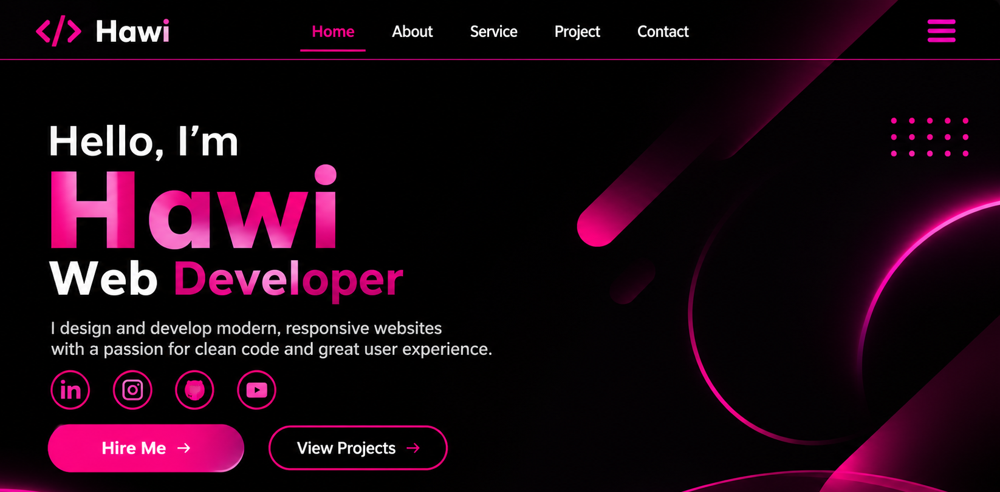

# 🌐 My Personal Portfolio Website

## About the Project
This is my personal portfolio website, created to introduce myself, showcase my skills, display my projects, and provide contact information.

## 🚀 Features
- Responsive website design
- Home and About sections
- Skills and Services sections
- Projects showcase
- Contact section
- Social media links

## 🛠️ Technologies Used
- HTML5
- CSS3
- JavaScript

## 📸 Website Screenshot

## 🔗 Live Demo
Add your deployed website link here.

## 📂 Installation
1. Clone this repository.
2. Open the project folder.
3. Open `index.html` in your browser.

## 👩‍💻 Author
Frontend Web Developer

## 📬 Contact
- GitHub:my githublink ( https://github.com/hawi199)
- LinkedIn: my linkedin link ( https://www.linkedin.com/in/hawi-zewdie-9a1796449/)
